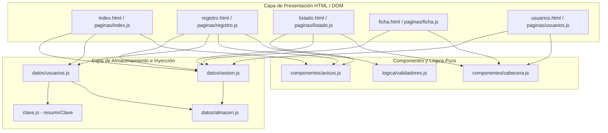

# Club Ciclista Pedal & Cadencia

Aplicación web de gestión integral para el **Club Ciclista Pedal & Cadencia**. Diseñada con estética deportiva inspirada en Specialized, permite a los socios registrarse, gestionar su perfil de membresía ciclista, su licencia federativa y su parque de bicicletas (de 0 a 3 por socio).

**Web publicada:** https://club-ciclista-pedal-cadencia.vercel.app

## Mi proyecto

### La entidad: Socio Ciclista

| Campo | Control | Obligatorio | Regla de validación | Mensaje si no se cumple |
|-------|---------|:-----------:|---------------------|-------------------------|
| Nombre completo | Texto (`input[text]`) | Sí | Solo letras y espacios, 3-50 caracteres | Introduce un nombre válido (mínimo 3 letras). |
| DNI | Texto (`input[text]`) | Sí | Formato `12345678X` y letra válida según módulo 23 | El DNI debe tener 8 dígitos y la letra de control correcta. |
| Fecha nacimiento | Fecha (`input[date]`) | Sí | Fecha pasada, mayor de 14 años | Debes tener al menos 14 años para inscribirte. |
| Categoría | Desplegable (`select`) | Sí | Opción válida (Sub-23, Élite, Máster 30, Máster 40, Cicloturista) | Selecciona una categoría ciclista. |
| Cuota mensual | Número (`input[number]`) | Sí | Valor numérico entre 10 y 200 € | La cuota debe estar entre 10 y 200 €. |
| ¿Federado? | Casilla (`input[checkbox]`) | No | Booleano | - |
| Licencia federativa *(Condicional)* | Texto (`input[text]`) | Sí (si federado) | Formato `FED-(CAR\|MTB\|GRA)-\d{5}` (hidden y disabled si no federado) | Formato de licencia inválido (ej. FED-CAR-12345). |
| Bicicletas *(Grupo dinámico, 0-3)* | `<template>` con texto y select | No | Máximo 3 bicicletas por socio | Máximo alcanzado (3 bicicletas). |

### El registro de usuarios

| Campo | Control | Regla | Mensaje |
|-------|---------|-------|---------|
| Nombre de usuario | `input[text]` | `/^[a-zA-Z0-9_]{3,20}$/` y no repetido | El nombre de usuario debe ser válido y no estar ocupado. |
| Correo electrónico | `input[email]` | Formato de correo válido | Introduce una dirección de correo válida. |
| Contraseña | `input[password]` | Mínimo 8 caracteres, minúscula (`\p{Ll}`), mayúscula (`\p{Lu}`) y cifra (`\d`) | La contraseña no cumple todos los requisitos exigidos. |
| Repetir contraseña | `input[password]` | Coincidir exactamente con la contraseña | Las contraseñas deben ser exactamente iguales. |
| Aceptación | `input[checkbox]` | Marcada obligatoriamente | Debes aceptar las condiciones para formalizar el alta. |

### Páginas

| Página | Acceso | Qué hace |
|--------|--------|----------|
| `index.html` | Pública | Portada con Hero deportivo estilo Specialized e inicio de sesión. Si hay sesión, redirige a `listado.html`. |
| `registro.html` | Pública | Formulario de alta con validación de requisitos de contraseña en tiempo real. |
| `listado.html` | Usuarios | Listado principal de socios con buscador debounced y paginación sincronizada con la URL. |
| `ficha.html` | Usuarios | Alta (`ficha.html`) y edición (`ficha.html?id=...`) de fichas de socios con campo condicional y grupo dinámico. |
| `usuarios.html` | Administradores | Zona exclusiva para administradores donde consultar usuarios y cambiar roles. |

## Arquitectura y módulos

- **Patrones de diseño identificados:**
  1. **Inyección de Dependencias (DI):** Los módulos de datos reciben el almacén como parámetro opcional (por defecto `localStorage` o `sessionStorage`), permitiendo sustituirlos en los tests unitarios por `AlmacenFalso` sin tocar código de producción.
  2. **Observador / Event-Driven (CustomEvent):** El sistema de notificaciones está totalmente desacoplado mediante el evento nativo personalizado `aviso` con propagación por burbuja (`bubbles: true`).

## Cómo ejecutarlo

1. **Abrir en Dev Container:** Abrir la carpeta del proyecto en VS Code y seleccionar `Dev Containers: Reopen in Container`.
2. **Servidor local:** La web se sirve en `http://localhost:3901`.
3. **Comandos de desarrollo y calidad:**
   - `npm test`: Ejecuta los tests unitarios con Vitest.
   - `npm run lint`: Comprueba el código con ESLint.
   - `npm run format:check`: Verifica el formateo con Prettier.
   - `npm run format`: Corrige el formato automáticamente.
   - `npm run build`: Compila la web en la carpeta `dist/`.

## Almacenamiento y sesión

| Clave | Almacén | Qué guarda | Ejemplo |
|-------|---------|------------|---------|
| `club_usuarios` | `localStorage` | Array de usuarios registrados con contraseñas hasheadas | `[{"usuario":"admin","rol":"administrador","claveHash":"8c6976e5...","correo":"admin@club.es"}]` |
| `club_sesion_activa` | `sessionStorage` | Datos del usuario conectado en la pestaña | `{"usuario":"admin","rol":"administrador","horaInicio":"2026-11-05T17:00:00.000Z"}` |
| `club_aviso_pendiente` | `sessionStorage` | Notificación temporal para la siguiente página | `{"mensaje":"¡Bienvenido!","tipo":"success"}` |

- **Roles y Guards:**
  - El primer usuario registrado se convierte automáticamente en `administrador`; los posteriores son `usuario`.
  - Las páginas privadas ejecutan `protegerPaginaPrivada()`, que redirige a `index.html` con `location.replace` si no hay sesión.
  - `usuarios.html` ejecuta `protegerPaginaAdmin()`, redirigiendo a `listado.html` con un aviso de error si el rol no es administrador.

## Funcionalidad y formularios

- **Validación en tiempo real:**
  - Los formularios usan `novalidate` para anular la interfaz nativa del navegador y usar la nuestra.
  - La contraseña en `registro.html` analiza dinámicamente cuatro requisitos (`\p{Ll}`, `\p{Lu}`, cifra y longitud) con eventos `input`, actualizando el DOM en vivo con ticks verdes.
  - Se controla el doble envío (`enviando = true` y botón desactivado) durante el cálculo asíncrono del hash SHA-256.

## Eventos

### Eventos en el HTML
Se aprovecha el comportamiento nativo del HTML: envío con `Intro`, validación de campos requeridos y etiquetas `<label for="...">`. Cero atributos `on...` en línea.

### Tipos de eventos
- `submit` en lugar de `click`: Permite el envío tanto al hacer clic en el botón como al presionar Intro en cualquier campo.
- `input` para reactividad en vivo en los requisitos de contraseña.
- `CustomEvent('aviso')`: Notificaciones que suben por burbuja hasta `document`.

## Pruebas y cobertura

| Nivel | Fichero | Qué prueba |
|-------|---------|------------|
| Unitario | `tests/unitarios/usuarios.test.js` | Módulo de usuarios con `AlmacenFalso`: creación, primer admin, repetidos, autenticación y datos corruptos. |
| Unitario | `tests/unitarios/sesion.test.js` | Módulo de sesión con `AlmacenFalso`: inicio, fin, rol admin y datos corruptos. |
| Unitario | `tests/unitarios/validadores.test.js` | Validadores de registro con tablas `it.each`: límites, formatos y motivos de rechazo. |

## Integración continua

### ESLint y Prettier

Reglas añadidas a `eslint.config.js`:
1. `camelcase: 'error'`: Obliga a utilizar la convención camelCase en identificadores de variables y funciones, evitando mezclas con snake_case o PascalCase en variables locales.
2. `curly: 'error'`: Exige el uso obligatorio de llaves `{}` en todas las estructuras de control (`if`, `else`, `for`, `while`), evitando bugs clásicos como ejecuciones accidentales fuera del bloque.
3. `no-console: ['warn', { allow: ['warn', 'error'] }]`: Advierte sobre cualquier `console.log` de depuración que se haya olvidado en el código fuente, permitiendo únicamente advertencias y errores intencionados.

### El workflow

`.github/workflows/ci.yml` se ejecuta con cada `push` y `pull_request` hacia la rama `main`.

| Trabajo | Espera a | Pasos | Artefacto |
|---------|----------|-------|-----------|
| `Calidad` | — | Checkout, Setup Node 24, `npm ci`, `npm run lint`, `npm run format:check` | — |
| `Tests` | `Calidad` | Checkout, Setup Node 24, `npm ci`, `npm test` | — |
| `E2E` | `Tests` *(Sprint 2)* | Instalación de Chromium y Playwright | `playwright-report/` (si falla) |

## Despliegue continuo

*(Se completará en el Sprint 3 con Vercel).*

## Organización del trabajo

### Definición de Hecho

Para que una tarea se considere **Hecha** en el tablero de Trello, debe cumplir obligatoriamente:
- [x] El código sigue los estándares de calidad: `npm run lint` y `npm run format:check` pasan sin errores ni advertencias.
- [x] Tiene pruebas unitarias asociadas que cubren casos nominales, casos límite y entradas corruptas o inválidas.
- [x] Todos los tests pasan en local (`npm test`).
- [x] Los componentes creados son accesibles (`role="status"`, `aria-describedby`, `aria-invalid`, `labels`).
- [x] Se integra mediante Pull Request en una rama dedicada sin mezclar cambios ajenos.
- [x] El pipeline de GitHub Actions (`ci.yml`) finaliza en verde.

### Sprints

| Sprint | *Tag* | Qué incluye | Reflexión |
|--------|-------|-------------|-----------|
| 1 | `v0.1` | Autenticación, sesión, roles, maquetación base estilo Specialized, tests unitarios y CI Paso 1. | La estructuración modular inicial ha facilitado enormemente probar el almacenamiento de usuarios sin depender del navegador real gracias a `AlmacenFalso`. La integración de `resumirClave` mediante promesas requirió especial cuidado en el control de envíos duplicados. |
| 2 | `v0.2` | Entidad y CRUD de Socios, plantillas `<template>`, paginación y CI completo. | *(En curso)* |
| 3 | `v1.0` | Despliegue en Vercel, E2E desplegado, Release final y documentación. | *(Pendiente)* |

**Tablero de Trello:** [Club Ciclista Pedal & Cadencia](https://trello.com/b/bP2c4qe1/club-ciclista-pedal-cadencia)

**Blog del proyecto:** [blog/README.md](blog/README.md)

### Ramas y versiones

- **Estrategia de ramas:** Cada funcionalidad se desarrolla en una rama específica (`feature/auth-sesion`, `feature/crud-socios`, etc.) y se incorpora a `main` a través de Pull Request tras verificar los checks automáticos.
- **`.gitignore`:** Excluye `node_modules/` (dependencias pesadas instaladas vía `package-lock.json`), `dist/` (archivos compilados por el script de build), informes temporales de pruebas y cobertura (`coverage/`, `playwright-report/`), y ficheros del sistema operativo (`.DS_Store`, `Thumbs.db`, `.vscode/`).

**Versión de entrega:** `v1.0`
