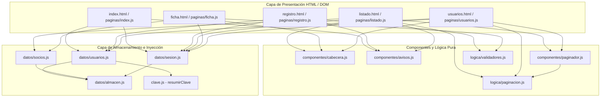

# Club Ciclista Pedal & Cadencia

Aplicación web de gestión integral para el **Club Ciclista Pedal & Cadencia**. Diseñada con estética deportiva inspirada en Specialized, permite a los socios registrarse, gestionar su perfil de membresía ciclista, su licencia federativa y su parque de bicicletas (de 0 a 3 por socio).

**Web publicada:** https://club-ciclista-pedal-cadencia.vercel.app

## Mi proyecto

### La entidad: Socio Ciclista

| Campo | Control | Obligatorio | Regla de validación | Mensaje si no se cumple |
|-------|---------|:-----------:|---------------------|-------------------------|
| Nombre completo | Texto (`input[text]`) | Sí | Entre 3 y 80 caracteres | El nombre debe tener al menos 3 caracteres. |
| DNI | Texto (`input[text]`) | Sí | Formato `^\d{8}[A-Za-z]$`, letra módulo 23 y no duplicado | La letra del DNI no es correcta (para XXXXXXXX corresponde la «Z»). |
| Fecha nacimiento | Fecha (`input[date]`) | Sí | Formato `YYYY-MM-DD`, fecha real pasada (>= 1920 y no futura) | La fecha de nacimiento no puede ser futura. |
| Categoría | Desplegable (`select`) | Sí | Opción válida (`Sub-23`, `Élite`, `Máster 30`, `Máster 40`, `Cicloturista`) | Selecciona una categoría ciclista. |
| Cuota mensual | Número (`input[number]`) | Sí | Valor numérico entre 10 y 500 € | La cuota mensual debe situarse entre 10 € y 500 €. |
| ¿Federado? | Casilla (`input[checkbox]`) | No | Booleano | - |
| Licencia federativa *(Condicional)* | Texto (`input[text]`) | Sí (si federado) | Formato `^[A-Za-z0-9-]{4,20}$` (`hidden` y `disabled` si no federado) | La licencia debe tener entre 4 y 20 caracteres alfanuméricos o guiones. |
| Bicicletas *(Grupo dinámico, 0-3)* | `<template>` con texto y select | No | De 0 a 3 bicicletas; cada una requiere marca y modelo (>= 2 caracteres) | La marca / El modelo debe tener al menos 2 caracteres. |

### El registro de usuarios

| Campo | Control | Regla | Mensaje |
|-------|---------|-------|---------|
| Nombre de usuario | `input[text]` | `/^[a-zA-Z0-9_]{3,20}$/` y no repetido | El nombre de usuario debe ser válido y no estar ocupado. |
| Correo electrónico | `input[email]` | Formato de correo válido | Introduce una dirección de correo válida. |
| Contraseña | `input[password]` | Mínimo 8 caracteres, minúscula (`\p{Ll}`), mayúscula (`\p{Lu}`) y cifra (`\d`) | La contraseña no cumple todos los requisitos exigidos. |
| Repetir contraseña | `input[password]` | Coincidir exactamente con la contraseña | Las contraseñas deben ser exactamente iguales. |
| Aceptación | `input[checkbox]` | Marcada obligatoriamente | Debes aceptar las condiciones para formalizar el alta. |

### Páginas

| Página | Acceso | Qué hace |
|--------|--------|----------|
| `index.html` | Pública | Portada con Hero deportivo alpino (Innsbruck) estilo Specialized e inicio de sesión con botón de visibilidad de contraseña (`👁️`/`🙈`). Si hay sesión, redirige a `listado.html`. |
| `registro.html` | Pública | Formulario de alta con validación de requisitos de contraseña en tiempo real y botones de alternancia de visibilidad de contraseña. |
| `listado.html` | Usuarios | Listado dinámico de socios generado con `<template>` y `textContent`, buscador con `debounce` insensible a mayúsculas/tildes, paginación sincronizada con `?pagina=X` y diálogo nativo `<dialog>` para confirmar bajas. |
| `ficha.html` | Usuarios | Alta (`ficha.html`) y edición (`ficha.html?id=...`) de fichas de socios con lectura `FormData`, campo condicional (`hidden` + `disabled`) y grupo dinámico de bicicletas (0 a 3). |
| `usuarios.html` | Administradores | Zona exclusiva para administradores con listado paginado, buscador y cambio de rol (`administrador` <-> `usuario`), bloqueando la autodegradación del administrador activo. |

## Arquitectura y módulos

- **Patrones de diseño identificados:**
  1. **Inyección de Dependencias (DI):** Los módulos de datos reciben el almacén como parámetro opcional (por defecto `localStorage` o `sessionStorage`), permitiendo sustituirlos en los tests unitarios por `AlmacenFalso` sin tocar código de producción.
  2. **Observador / Event-Driven (`CustomEvent`):** El sistema de notificaciones está totalmente desacoplado mediante el evento nativo personalizado `aviso` con propagación por burbuja (`bubbles: true`).
  3. **Separación de Lógica Pura y DOM:** Los validadores (`js/logica/validadores.js`) y la paginación (`js/logica/paginacion.js`) son funciones puras sin efectos secundarios, alcanzando el 100 % de cobertura de líneas.

## Cómo ejecutarlo

1. **Abrir en Dev Container:** Abrir la carpeta del proyecto en VS Code y seleccionar `Dev Containers: Reopen in Container`.
2. **Servidor local:** La web se sirve en `http://localhost:3901`.
3. **Comandos de desarrollo y calidad:**
   - `npm test`: Ejecuta los tests unitarios y de integración con Vitest.
   - `npm run coverage`: Mide la cobertura de código (umbral mínimo exigido: 90 % en líneas; actual: **99.28 %**).
   - `npm run e2e`: Ejecuta las pruebas extremo a extremo con Playwright en Chromium.
   - `npm run lint`: Comprueba el código con ESLint.
   - `npm run format:check`: Verifica el formateo con Prettier.
   - `npm run format`: Corrige el formato automáticamente.
   - `npm run build`: Compila la web en la carpeta `dist/`.

## Almacenamiento y sesión

| Clave | Almacén | Qué guarda | Ejemplo |
|-------|---------|------------|---------|
| `club_usuarios` | `localStorage` | Array de usuarios registrados con contraseñas hasheadas | `[{"usuario":"admin","rol":"administrador","claveHash":"8c6976e5...","correo":"admin@club.es"}]` |
| `socios_<usuario>` | `localStorage` | Array de socios ciclistas pertenecientes a ese usuario | `[{"id":"...","nombre":"Álvaro Valero","dni":"12345678Z","categoria":"Élite","cuota":45,"federado":true,"licencia":"ESP-2026-01","bicicletas":[...]}]` |
| `club_sesion_activa` | `sessionStorage` | Datos del usuario conectado en la pestaña | `{"usuario":"admin","rol":"administrador","horaInicio":"2026-11-05T17:00:00.000Z"}` |
| `club_aviso_pendiente` | `sessionStorage` | Notificación temporal para la siguiente página | `{"mensaje":"¡Bienvenido!","tipo":"success"}` |

## Funcionalidad y formularios

- **Validación en tiempo real y accesibilidad:**
  - Los formularios usan `novalidate`. La primera validación de cada campo se dispara al salir de él (`blur` escuchado en el formulario en **fase de captura**), y las siguientes al escribir (`input` en **fase de burbuja**).
  - Cada campo erróneo recibe `aria-invalid="true"`, la clase `is-invalid` y muestra el motivo exacto en su contenedor enlazado por `aria-describedby`.
  - Si se intenta enviar un formulario con errores, se emite un aviso accesible (`role="status"`) y se traslada el foco (`.focus()`) al primer campo inválido.
- **Campo condicional y grupo dinámico:**
  - La licencia federativa combina `hidden` y `disabled` cuando la casilla ¿Federado? no está activa.
  - Las bicicletas se clonan desde `<template id="plantilla-bicicleta">` asignando IDs y `<label for="...">` únicos para cada fila (de 0 a 3 bicicletas).

## Eventos

- `submit` en lugar de `click` para el envío de formularios.
- `blur` en fase de captura (`addEventListener('blur', ..., true)`) para detectar la primera salida de cualquier campo del formulario, e `input` en fase de burbuja para actualizar la validación en vivo.
- `input` con `debounce` (`setTimeout` / `clearTimeout` de 250 ms) en los buscadores de socios y usuarios.
- `CustomEvent('aviso')` con `bubbles: true` escuchado en `document`.

## Pruebas y cobertura

| Nivel | Fichero | Qué prueba |
|-------|---------|------------|
| Unitario | `tests/unitarios/usuarios.test.js` | Módulo de usuarios y cambio de roles con `AlmacenFalso`. |
| Unitario | `tests/unitarios/sesion.test.js` | Módulo de sesión y guards con `AlmacenFalso`. |
| Unitario | `tests/unitarios/socios.test.js` | CRUD completo de socios por usuario, duplicados de DNI, normalización de bicicletas y búsqueda sin tildes. |
| Unitario | `tests/unitarios/validadores.test.js` | Validadores de registro y ficha (DNI módulo 23, fechas, cuotas, licencias) con tablas `it.each` (60 casos). |
| Unitario | `tests/unitarios/paginacion.test.js` | Función pura `paginar()` e inmutabilidad, junto con lectura/escritura de `?pagina=X` en `URLSearchParams`. |
| Integración | `tests/integracion/listado.test.js` | Listado en Happy-DOM: `<template>`, buscador con `debounce` (`vi.useFakeTimers`) y borrado con `<dialog>`. |
| Integración | `tests/integracion/ficha.test.js` | Ficha en Happy-DOM: campo condicional (`hidden`/`disabled`), grupo dinámico (0 a 3), alta con `FormData` y edición `?id=...`. |
| Integración | `tests/integracion/registro.test.js` | Validación `blur`/`input`, `aria-invalid`, foco al primer error y botón ojito de contraseña. |
| Integración | `tests/integracion/usuarios.test.js` | Protección de rol administrador, bloqueo del propio rol y cambio de permisos en `usuarios.html`. |
| E2E (Playwright) | `e2e/sesion.spec.js` | Recorrido real en Chromium: guard sin sesión, registro de primer admin, cierre de sesión y login. |
| E2E (Playwright) | `e2e/crud.spec.js` | Recorrido real en Chromium: alta con licencia y bicicleta, persistencia tras recargar, edición y baja en `<dialog>`. |
| Humo (Playwright) | `e2e/humo.spec.js` | Prueba de humo de la aplicación pública: verifica respuesta HTTP 200, renderizado del acceso y navegación a inscripción. |

## Integración continua

### ESLint y Prettier

Reglas añadidas a `eslint.config.js`:
1. `camelcase: 'error'`: Obliga a utilizar la convención camelCase en identificadores de variables y funciones.
2. `curly: 'error'`: Exige el uso obligatorio de llaves `{}` en todas las estructuras de control (`if`, `else`, `for`, `while`).
3. `no-console: ['warn', { allow: ['warn', 'error'] }]`: Advierte sobre cualquier `console.log` olvidado en el código.

### Los workflows de GitHub Actions

1. **`.github/workflows/ci.yml`** (`push` y `pull_request` hacia `main`):

| Trabajo | Espera a | Pasos | Artefacto |
|---------|----------|-------|-----------|
| `Calidad` | — | Checkout, Setup Node 24, `npm ci`, `npm run lint`, `npm run format:check` | — |
| `Tests` | `Calidad` | Checkout, Setup Node 24, `npm ci`, `npm run coverage` (umbral >= 90 %) | `coverage-report` (`coverage/`) |
| `E2E` | `Tests` | Checkout, Setup Node 24, `npm ci`, instalar Chromium, `npm run e2e` | `playwright-report` (`playwright-report/` si falla) |

2. **`.github/workflows/despliegue.yml`** (`deployment_status` emitido por Vercel):
   - Ejecuta el trabajo `E2E desplegado` cuando `github.event.deployment_status.state == 'success'`, lanzando `npm run e2e` con `BASE_URL` apuntando a la URL real desplegada por Vercel.

3. **`.github/workflows/release.yml`** (`push` de etiquetas `v*`):
   - **Trabajo `Comprobar`:** Ejecuta `lint`, `format:check`, `coverage`, `docs` y `build`.
   - **Trabajo `Humo`:** Ejecuta `npx playwright test e2e/humo.spec.js` contra la web desplegada (`BASE_URL`).
   - **Trabajo `Release`:** Empaqueta `dist/` en un archivo `.zip` y publica la Release oficial en GitHub con `gh release create --generate-notes`.

## Despliegue continuo

- **Configuración en Vercel:**
  - **Framework Preset:** `Other`
  - **Build Command:** `npm run build`
  - **Output Directory:** `dist`
  - **Deployment Checks:** Configurados con los cuatro trabajos de verificación (`Calidad`, `Tests`, `E2E` y `E2E desplegado`) para que Vercel solo promueva a producción los despliegues que superen todas las pruebas.
- **Evidencias de despliegue y retención:**
  - Comprobaciones en Pull Request y vista previa: `img/pr-comprobaciones.png`
  - Versión retenida en Vercel cuando falla un check de bloqueo antes de promoción a producción: `img/vercel-retenido.png`

## Organización del trabajo

### Definición de Hecho

Para que una tarea se considere **Hecha** en el tablero de Trello, debe cumplir obligatoriamente:
- [x] El código sigue los estándares de calidad: `npm run lint` y `npm run format:check` pasan sin errores ni advertencias.
- [x] Tiene pruebas unitarias y de integración asociadas que cubren casos nominales, casos límite y entradas corruptas o inválidas (`npm run coverage` >= 90 %).
- [x] Todos los tests unitarios, de integración y E2E pasan en local (`npm test` y `npm run e2e`).
- [x] Los componentes creados son accesibles (`role="status"`, `aria-describedby`, `aria-invalid`, `labels`).
- [x] Documentación JSDoc actualizada y verificada con `npm run docs`.
- [x] Se integra desde su rama dedicada hacia `main`.
- [x] El pipeline de GitHub Actions (`ci.yml`) finaliza en verde.

### Sprints

| Sprint | *Tag* | Qué incluye | Reflexión |
|--------|-------|-------------|-----------|
| 1 | `v0.1` | Autenticación, sesión, roles, maquetación base estilo Specialized, tests unitarios y CI Paso 1. | La estructuración modular inicial ha facilitado enormemente probar el almacenamiento de usuarios sin depender del navegador real gracias a `AlmacenFalso`. La integración de `resumirClave` mediante promesas requirió especial cuidado en el control de envíos duplicados. |
| 2 | `v0.2` | Entidad y CRUD de Socios, plantillas `<template>`, campo condicional, grupo dinámico (0 a 3 bicicletas), paginación sincronizada con URL, panel de administración, tests en Happy-DOM, E2E con Playwright y CI Paso 2 con cobertura >= 90 %. | Separar la lógica pura (`paginar`, `validarDni`, `normalizarTextoBusqueda`) de los controladores DOM nos permitió alcanzar un 99.28 % de cobertura de líneas de forma natural. El uso de `blur` en fase de captura combinado con `input` en burbuja ofrece una experiencia de validación muy fluida sin agobiar al usuario antes de que termine de escribir por primera vez. |
| 3 | `v1.0` | Workflows de pruebas contra despliegues (`despliegue.yml`), prueba de humo (`e2e/humo.spec.js`), publicación automatizada de Release (`release.yml`) y documentación completa JSDoc (`npm run docs`). | Automatizar la validación posdespliegue mediante `deployment_status` y `BASE_URL` en Playwright cierra el ciclo entre integración continua y entrega en producción, asegurando que el artefacto estático compilado en `dist/` funciona exactamente igual que en el entorno de desarrollo. |

**Tablero de Trello:** [Club Ciclista Pedal & Cadencia](https://trello.com/b/bP2c4qe1/club-ciclista-pedal-cadencia)

**Blog del proyecto:** [blog/README.md](blog/README.md)

### Ramas y versiones

- **Estrategia de ramas:** Cada funcionalidad se desarrolla en una rama específica (`feature/sprint-2-crud-datos-socios`, `feature/sprint-2-paginacion`, `feature/sprint-2-listado-dinamico`, `feature/sprint-2-formulario-ficha`, etc.) y se fusiona en `main` tras superar todas las verificaciones.
- **`.gitignore`:** Excluye `node_modules/`, `dist/`, informes temporales de pruebas y cobertura (`coverage/`, `playwright-report/`, `test-results/`), y ficheros del sistema operativo.

**Versión de entrega:** `v1.0`
